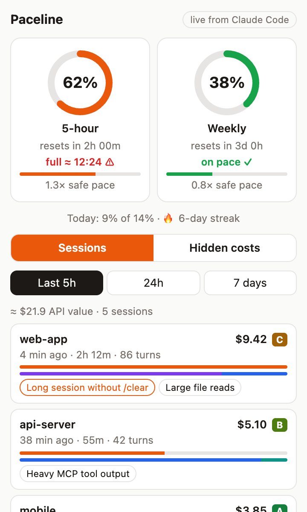
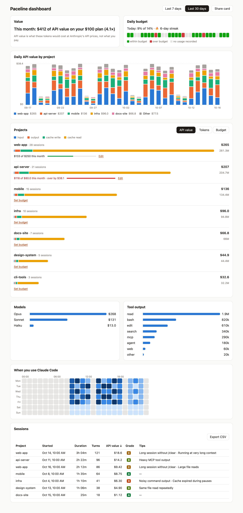

# Paceline — usage meter for Claude Code

[](https://github.com/mn-youssef/paceline/actions/workflows/ci.yml)

Paceline is a browser extension for Chrome, Edge, Brave and Arc. It shows how much of your Claude Code usage limit you have used, warns you before you hit it, and tells you which sessions used your tokens and why.

It has two parts that work together:

- **The extension**, in your browser: the toolbar badge, the popup, alerts and the dashboard.
- **The helper** (`paceline`), a small program on your computer. It reads Claude Code's local session logs and passes the numbers to the extension. It has no server and makes no network requests.

## Screenshots

<p align="center">
  
</p>
<p align="center"><sub>The popup: both limits with a forecast, today's budget, and the sessions that used the most, with tips.</sub></p>

<p align="center">
  
</p>
<p align="center"><sub>The dashboard: 30 days of API value by project, models, tools, when you work, and every session with its grade.</sub></p>

<p align="center"><sub>Screenshots use made-up data. Regenerate them with <code>pnpm --filter @paceline/extension screenshots</code>.</sub></p>

## What it does

**At a glance**
- **Badge** on the toolbar icon: your 5-hour or weekly limit %, green under 50 %, orange from 50 %, red from 80 %.
- **Forecast** under each gauge: for example "full ≈ 15:10 ⚠" when your current pace would use up the limit before it resets, and a safe-pace meter.

**Alerts**
- Notifications at 50 %, 80 % and 95 % of your limit (you can change these), with quiet hours.
- An **on-pace alert** when you're heading for your limit, early enough to change course.
- A **confetti** celebration when a limit you were using resets.

**Insights**
- **Top sessions** for the last 5 hours, 24 hours or 7 days, each with concrete tips from what actually happened. For example: "This session ran 3h without /clear" or "60 % of tool tokens were file reads".
- **Efficiency grade** (A to F) for every session, based on how much of its cost was avoidable.
- **Hidden costs:** cache misses after pauses, per-project setup overhead (MCP servers, CLAUDE.md), subagents and long context.
- **Dashboard** for 7 or 30 days:
  - daily API value by project, model mix, tool output, and an hour × weekday heatmap;
  - a sortable sessions table with CSV export.
- **Projects**: tokens (input, output, cache) and API value per project for 7 or 30 days. Click a project to see its models, tools, MCP servers, skills, cache expiries and subagent share.

**Habits**
- A **daily budget** as a share of your weekly limit, with a streak of days within budget.
- A **weekly digest** every Monday morning.
- A **share card** image of your week or month.

The dollar amounts are **API value**: what the same tokens would cost at Anthropic's API prices. On a Pro or Max plan that's not what you pay; it's a way to compare sessions and see how much use you get from your plan.

## Requirements

- **Claude Code**, used at least once.
- A **Pro or Max plan** for the limit %. On an API key, sessions, tips and the dashboard still work.
- **Node.js 18 or newer** for the helper (`node --version`).
- **A Chromium browser:** Chrome, Edge, Brave, Chromium, or Arc on macOS.
- **macOS or Linux.** Windows is supported in the code but not tested yet.

## Install

Install the extension first, then the helper.

### From source (works today)

You also need **Git** and **Node.js 22.12 or newer** to build.

**1. Turn on pnpm** (it comes with Node.js):

```bash
corepack enable
```

**2. Get the code:**

```bash
git clone https://github.com/mn-youssef/paceline.git
```

```bash
cd paceline
```

**3. Install the dependencies:**

```bash
pnpm install
```

**4. Build the extension and the helper:**

```bash
pnpm gen:dev-key
pnpm build
```

**5. Install the extension in your browser:**

1. Open `chrome://extensions` (in Edge: `edge://extensions`).
2. Turn on **Developer mode** (top right).
3. Click **Load unpacked** and choose the folder `packages/extension/.output/chrome-mv3`.
4. Click the puzzle icon in the toolbar and pin **Paceline**.

**6. Install the helper:**

```bash
node packages/helper/dist/paceline.cjs install
```

It copies itself to `~/.paceline/`, registers with your browsers, adds its status line to Claude Code (keeping yours, if you had one) and indexes your session logs. You should see:

```text
✓ Helper installed in /Users/you/.paceline
✓ Registered with Chrome, Edge
✓ Status line added to ~/.claude/settings.json
✓ Indexed 713 session logs

Done. Open the Paceline extension: it should say Connected.
```

**7. Check it:** send one message in Claude Code **in a terminal**. Within a minute the badge shows your limit %, and the popup says **Connected**.

### From the Chrome Web Store and npm (coming soon)

Once Paceline is published, installing takes two steps:

1. Add **Paceline** from the Chrome Web Store.
2. In a terminal, run:

   ```bash
   npx paceline install
   ```

From here on, the commands are written as `npx paceline …`. For a source install, use `node packages/helper/dist/paceline.cjs …` from the repository folder instead. After the first install you can also use the installed copy from anywhere: `node ~/.paceline/paceline.cjs …`.

## Check your setup: `doctor`

```bash
npx paceline doctor
```

Every line should start with ✓:

```text
✓ helper           /Users/you/.paceline/paceline.cjs
✓ node             /usr/local/bin/node
✓ browsers         Registered for Chrome, Edge
✓ statusline       Installed in ~/.claude/settings.json
✓ statusline-seen  Last ran 2 min ago
✓ rate-limits      5h 4% · 7d 33%, captured 2 min ago
✓ logs             /Users/you/.claude/projects
✓ index            713 log files indexed, 0 unreadable lines skipped
```

| If this line shows ✗ | Do this |
|---|---|
| `helper`, `node` or `statusline` | Run the install command again. |
| `browsers` | Open your browser once, then run the install command again. |
| `statusline-seen` or `rate-limits` | Send a message in Claude Code **in a terminal**. On an API key, `rate-limits` stays ✗, which is expected. |

`npx paceline doctor --json` prints the same checks with versions and platform. Add it when you report a problem.

### Using the Claude desktop app or an IDE?

Claude Code only reports your limit % to its status line in the **terminal**. If you mostly use the desktop app or an IDE extension:
1. Open Paceline **Options**.
2. Tick **Use my claude.ai session**. This reads the limit % from your signed-in claude.ai session. It's unofficial and off by default.

Sessions, tips and the dashboard work either way, because they come from your log files.

## Reinstall, repair and update

**Repair or reinstall:** running the install command again is always safe. It keeps your settings, your status line and the log index:

```bash
npx paceline install
```

**Clean reinstall:** remove everything, then install again:

```bash
npx paceline uninstall
```

```bash
npx paceline install
```

**Update a source install:**

1. Get the latest code:
   ```bash
   git pull
   ```
2. Install any new dependencies:
   ```bash
   pnpm install
   ```
3. Rebuild:
   ```bash
   pnpm gen:dev-key
   pnpm build
   ```
4. Update the helper:
   ```bash
   node packages/helper/dist/paceline.cjs install
   ```
5. In `chrome://extensions`, click the reload icon on Paceline.

**Update a store and npm install:** the browser updates the extension by itself. When the popup says **Helper needs an update**, run:

```bash
npx paceline@latest install
```

## Uninstall

**1. Remove the helper:**

```bash
npx paceline uninstall
```

This restores the Claude Code status line you had before, unregisters the helper from your browsers, and deletes `~/.paceline/`. Only `backups/` stays: a copy of your Claude Code settings from before the first install. To delete that too:

```bash
npx paceline uninstall --purge
```

**2. Remove the extension:** in `chrome://extensions`, click **Remove** on Paceline. This also deletes its settings and history.

Your Claude Code logs are never changed.

## Helper commands

| Command | What it does |
|---|---|
| `npx paceline install` | Install or repair: register with browsers, add the status line, index logs |
| `node packages/helper/dist/paceline.cjs install --extension-id <id>` | Source builds only: also allow an extension with another ID, for example your own build with a different key |
| `npx paceline doctor` | Check the setup |
| `npx paceline doctor --json` | The same checks as JSON |
| `npx paceline uninstall` | Remove everything except settings backups |
| `npx paceline uninstall --purge` | Remove everything, including backups |
| `npx paceline --version` | Show the helper version |

Claude Code and the browser run two more commands, `paceline statusline` and `paceline host`, on their own. You never need to run them.

## How it works

1. `install` sets Claude Code's status line to the helper. Each time Claude Code refreshes it, the helper saves the 5-hour and weekly limit % that Claude Code reports, then prints your own status line if you had one.
2. When the extension needs data, the browser starts the helper through Native Messaging. There is no background process and no open port. The helper reads your session logs incrementally, so it stays fast, and returns per-session totals, tips and dashboard data.
3. The extension refreshes every minute, updates the badge, and sends alerts and the weekly digest.

## Privacy

Paceline has no servers and collects nothing:
- The helper reads your logs on your computer and sends the extension only numbers, model, tool and project names, and file paths. Never your prompts, Claude's replies or file contents.
- The optional claude.ai fallback talks only to claude.ai, with your own session.

Full policy: [PRIVACY.md](PRIVACY.md).

## Documentation

The **[user guide](docs/guide.md)** explains every feature, every option, the alerts, the dashboard, the claude.ai fallback and troubleshooting in detail.

## Development

```bash
pnpm install
pnpm test                                   # all unit tests
pnpm typecheck
pnpm --filter paceline build                # helper → packages/helper/dist/paceline.cjs
node packages/helper/dist/paceline.cjs install
pnpm --filter @paceline/extension build     # load packages/extension/.output/chrome-mv3 unpacked
pnpm --filter @paceline/extension e2e       # Playwright smoke test (macOS/Linux)
pnpm smoke                                  # install the helper into a temporary home and talk to it
pnpm release:check                          # everything a release needs (see RELEASING.md)
```

The e2e test uses Playwright's Chromium (`pnpm --filter @paceline/extension exec playwright install chromium`). To use another Chromium or Chrome for Testing binary instead, set `PACELINE_E2E_CHROME=/path/to/binary`. Branded Google Chrome does not load unpacked extensions from the command line.

To publish a release, follow [RELEASING.md](RELEASING.md). The manual tests are in [docs/release-checklist.md](docs/release-checklist.md).

Source builds use a per-checkout development key in `packages/extension/dev-key.txt`. Generate it with `pnpm gen:dev-key`; it is ignored by Git and must not be shared. The helper derives the matching extension ID from that local key. Store builds use `pnpm --filter @paceline/extension zip`, which leaves the key out and writes to `packages/extension/.output-store/`, so it never changes the unpacked build in `.output/` that your browser loads.
